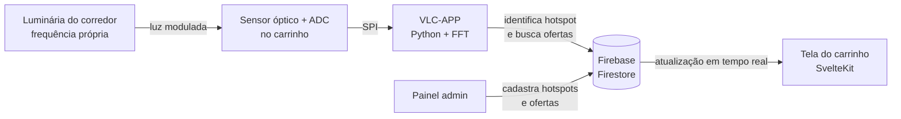

# VLCart — Ofertas no carrinho de supermercado via Visible Light Communication

> 🏆 **Melhor projeto da Residência em TIC (BRISA / SOFTEX)**

O VLCart é um sistema que mostra promoções em uma tela acoplada ao carrinho de supermercado, de acordo com o corredor onde o cliente está. A localização é feita com **VLC (Visible Light Communication)**: a iluminação de cada corredor pisca em uma frequência própria, imperceptível ao olho humano, e um sensor no carrinho identifica essa frequência para saber em qual seção da loja ele se encontra.

O projeto é dividido em dois repositórios:

| Repositório | Conteúdo |
|---|---|
| [js-BRISA-SOFTEX](https://github.com/Eduardo-Prates/js-BRISA-SOFTEX) | Front-end: painel administrativo e tela do carrinho (SvelteKit) |
| [VLC--brisa](https://github.com/JoaoVictorTubino/VLC--brisa) | Back-end embarcado: leitura do sinal VLC e atualização do carrinho (Python) |

## Como funciona



1. Cada **hotspot** (por exemplo, "Corredor de Frios e Laticínios") é associado a uma frequência de modulação da luz.
2. No carrinho, o leitor amostra o sinal do sensor via SPI a 2 kHz, aplica uma **FFT** sobre 4096 amostras e extrai a frequência dominante, agrupada em canais de 50 Hz a partir de 300 Hz.
3. A frequência detectada é comparada às frequências cadastradas dos hotspots, com tolerância de ±5 Hz.
4. O back-end busca as ofertas daquele hotspot e atualiza o documento do carrinho no Firestore.
5. A tela do carrinho escuta esse documento em tempo real e exibe as promoções do corredor atual.

## Funcionalidades

**Tela do carrinho (cliente)**
- Exibição em tempo real das ofertas do corredor em que o carrinho está.
- Atualização automática conforme o carrinho se move pela loja.

**Painel administrativo**
- Cadastro, edição e remoção de **hotspots** (corredores e suas frequências).
- Cadastro, edição e remoção de **ofertas** vinculadas a cada hotspot.

**Acesso**
- Login simplificado por CPF, com redirecionamento para a área de cliente ou de administrador (fluxo de demonstração).

## Tecnologias

| Camada | Tecnologias |
|---|---|
| Front-end | SvelteKit, Svelte 5, Tailwind CSS 4, Vite, Firebase Web SDK |
| Back-end embarcado | Python, NumPy, SciPy (FFT), spidev, Firebase Admin SDK |
| Banco de dados | Firebase Firestore (coleções `hotspots`, `ofertas`, `carrinhos`, `usuarios`, `supermercados`) |
| Hardware | Placa Linux com barramento SPI (ex.: Raspberry Pi), sensor óptico e conversor A/D de 12 bits |

## Como executar

### Front-end

```bash
git clone https://github.com/Eduardo-Prates/js-BRISA-SOFTEX.git
cd js-BRISA-SOFTEX/brisa-app
npm install
```

Crie um arquivo `.env` em `brisa-app/` com as credenciais do seu projeto Firebase:

```env
VITE_FIREBASE_API_KEY=
VITE_FIREBASE_AUTH_DOMAIN=
VITE_FIREBASE_DATABASE_URL=
VITE_FIREBASE_PROJECT_ID=
VITE_FIREBASE_STORAGE_BUCKET=
VITE_FIREBASE_MESSAGING_SENDER_ID=
VITE_FIREBASE_APP_ID=
VITE_FIREBASE_MEASUREMENT_ID=
```

```bash
npm run dev
```

Para popular o banco com dados de exemplo (supermercado, hotspots, ofertas e carrinho), coloque a chave de conta de serviço do Firebase em `brisa-app/admsdk.json` e rode:

```bash
node bd.cjs
```

### Back-end (no dispositivo do carrinho)

```bash
git clone https://github.com/JoaoVictorTubino/VLC--brisa.git
cd VLC--brisa/VLC-APP
pip install firebase-admin numpy scipy spidev
```

Coloque a chave de conta de serviço do Firebase em `VLC-APP/firebase_config.json` e execute:

```bash
python main.py
```

O sistema lê o sensor a cada segundo e atualiza o carrinho no Firestore até ser interrompido com `Ctrl+C`.

> ⚠️ Os arquivos `.env`, `admsdk.json` e `firebase_config.json` contêm credenciais e **não devem ser versionados**.

## Equipe

Projeto desenvolvido durante a Residência em TIC (BRISA / SOFTEX).

- **Eduardo Prates Tiadoro** — Front-end — [GitHub](https://github.com/Eduardo-Prates)
- **João Victor Tubino** — [GitHub](https://github.com/JoaoVictorTubino)
